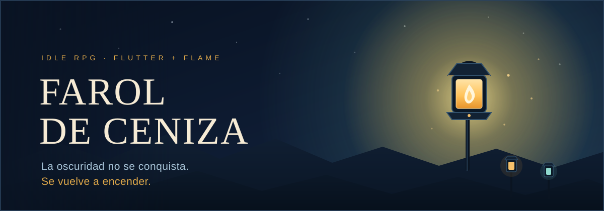
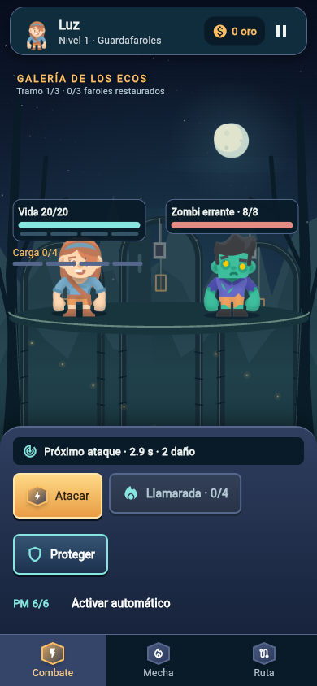
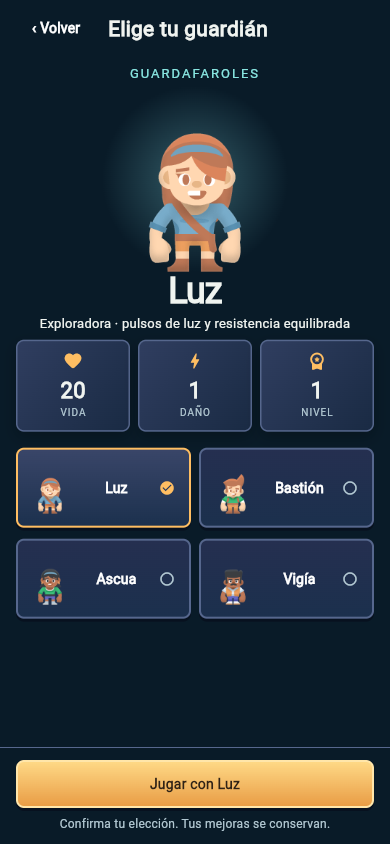
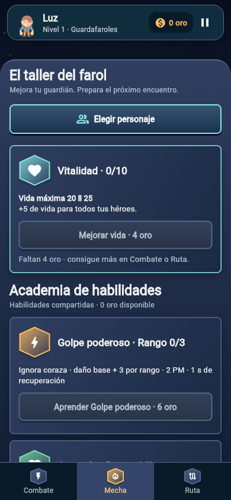
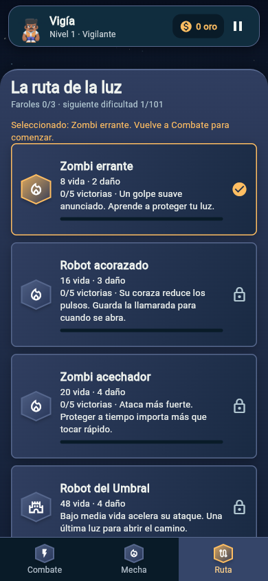
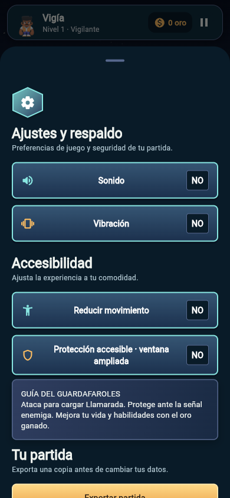
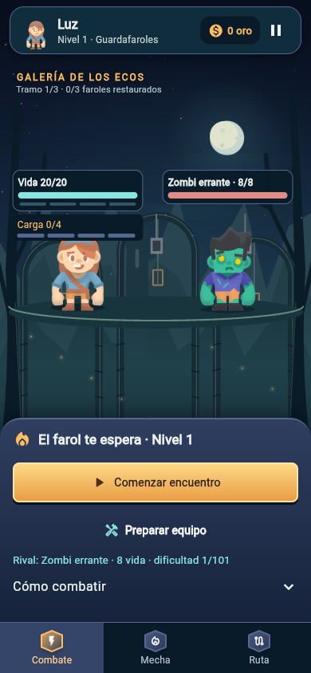
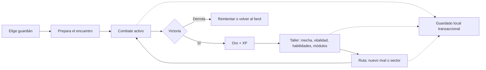

<div align="center">
  

  <br>

  **Un idle RPG cálido donde la luz se gana a pulso de farol.**
  Combate, decide, mejora y devuelve el brillo a una comarca cubierta de ceniza.

  <br>

  [](https://flutter.dev)
  [](https://dart.dev)
  [](https://flame-engine.org)
  [](#-verificación)
  [](LICENSE)
  [](#-empezar)
  [](#guardado-que-no-se-pierde)

  <br>

  [**Jugar el bucle**](#-el-bucle) · [**Ver capturas**](#-capturas) · [**Arquitectura**](#-bajo-el-capó) · [**Documentación**](#-documentación) · [**Estado**](#-estado-y-límites)

  <br>
</div>

---

## 🕯️ La ruta vuelve a brillar

Eres el **último guardafaroles** de una comarca donde la ceniza apagó los caminos. No conquistas un reino: recorres una galería antigua con tu farol, disipas criaturas de hollín y enciendes de nuevo los faroles que unían a los pueblos.

Cada victoria deja una señal visible. Cada mejora hace que tu luz llegue más lejos. Cada tramo restaurado devuelve un detalle del paisaje que la oscuridad había borrado.

> **Pitch:** un RPG de fantasía íntima, con combate activo y progresión idle, que se juega sin conexión, sin cuentas y sin anuncios.

**Farol de Ceniza** es un prototipo jugable y local: un juego completo de principio a fin en su primer ciclo, con una campaña acotada, un jefe final y un sistema de guardado pensado para no perder tu partida.

---

## 📸 Capturas

<table>
  <tr>
    <td align="center" width="33%">
      <br>
      <sub><b>Combate</b><br>Ataca, carga la llamarada y protege a tiempo.</sub>
    </td>
    <td align="center" width="33%">
      <br>
      <sub><b>Elige tu guardián</b><br>Cuatro héroes, cuatro formas de resistir la ceniza.</sub>
    </td>
    <td align="center" width="33%">
      <br>
      <sub><b>El taller del farol</b><br>Vitalidad, academia de habilidades y equipo.</sub>
    </td>
  </tr>
  <tr>
    <td align="center" width="33%">
      <br>
      <sub><b>La ruta de la luz</b><br>Rivales desbloqueables y dificultad acotada.</sub>
    </td>
    <td align="center" width="33%">
      <br>
      <sub><b>Ajustes y respaldo</b><br>Accesibilidad, sonido y exportación de partida.</sub>
    </td>
    <td align="center" width="33%">
      <br>
      <sub><b>Preparación</b><br>Conoce al rival antes de encender el farol.</sub>
    </td>
  </tr>
</table>

> Capturas propias de `docs/design-evidence/`, generadas desde la app en viewports móviles y de escritorio. Hay más en el [manifest de evidencia](docs/design-evidence/manifest.json).

---

## 🔥 El bucle



1. **Enciendes el encuentro.** El farol te dice a quién te enfrentas, su vida y su intención de ataque.
2. **Decides cada golpe.** Atacas a mano, cargas la llamarada o levantas la guarda. El modo automático es opcional, nunca obligatorio.
3. **Ganas oro y experiencia.** Cada victoria alimenta tu siguiente decisión.
4. **Vuelves al taller.** Subes la mecha, compras habilidades, amplías tu vitalidad y ajustas dos módulos.
5. **Abres la ruta.** Cinco victorias por sector encienden un farol; el jefe espera al final.
6. **Todo queda guardado.** Al cerrar y volver a abrir, tu partida sigue ahí.

### Un combate, en pequeño

| Acción | Qué hace | Coste / límite |
|---|---|---|
| **Atacar** | Golpe manual; también tocando la escena | Uno cada 350 ms |
| **Llamarada** | Triple daño (×4 con *Cristal*) | 4 ataques cargados (3 con *Pabilo*) |
| **Proteger** | Reduce el daño recibido un 75 % | Ventana de 1 s, recarga de 3 s |
| **Golpe poderoso** | Ignora coraza; +3 de daño por rango | 2 PM · 3 rangos |
| **Curación** | Recupera 6 de vida por rango | 2 PM · 3 rangos |
| **Sello de hielo** | Retrasa el ataque enemigo 1 s por rango | 2 PM · 3 rangos |
| **Automático** | Un ataque por segundo, sin cargar llamarada | Optativo, sin progreso offline |

---

## ⚔️ Lo que encontrarás

<table>
  <tr>
    <td width="50%" valign="top">
      <h3>Combatir con intención</h3>
      <ul>
        <li>Ataque manual, llamarada cargada y protección con ventana real.</li>
        <li>Intención enemiga anunciada: aprende cuándo proteger.</li>
        <li>Habilidades con maná, recarga y rangos.</li>
        <li>Modo automático para quien prefiera ver arder el farol.</li>
        <li>Pausa, derrota, reintento y abandono sin estados ocultos.</li>
      </ul>
    </td>
    <td width="50%" valign="top">
      <h3>Crecer sin inflación</h3>
      <ul>
        <li>Cuatro guardianes con vida, daño y estilo propios.</li>
        <li>Mejora de mecha con cinco compras y precio creciente.</li>
        <li>Diez niveles de vitalidad para todos los héroes.</li>
        <li>Cuatro módulos, dos ranuras, sin duplicados.</li>
        <li>Nivel máximo 5 y rango de dificultad acotado a 101.</li>
      </ul>
    </td>
  </tr>
  <tr>
    <td width="50%" valign="top">
      <h3>Una ruta con final</h3>
      <ul>
        <li>Tres sectores de cinco victorias y un jefe de dos fases.</li>
        <li>Encargos de cobro único que premian hazañas concretas.</li>
        <li>Rivales desbloqueables, sin peleas ocultas al elegir.</li>
        <li>Dificultad que sube con cada victoria, pero con techo.</li>
        <li>Cierre de campaña y combate repetible después.</li>
      </ul>
    </td>
    <td width="50%" valign="top">
      <h3>Jugar en cualquier sitio</h3>
      <ul>
        <li>Android, iOS y web desde el mismo código Dart.</li>
        <li>Guardado local offline-first, sin backend ni cuentas.</li>
        <li>Sin anuncios, compras, gacha ni servicios externos.</li>
        <li>Texto al 200 %, objetivos de 48 px y navegación semántica.</li>
        <li>Reducción de movimiento, sonido y vibración opcionales.</li>
      </ul>
    </td>
  </tr>
</table>

### Guardianes

| Héroe | Rol | Vida | Daño | Estilo |
|---|---|---:|---:|---|
| **Luz** | Guardafaroles | 20 | 1 | Equilibrada: pulsos de luz y resistencia justa |
| **Bastión** | Centinela | 28 | 1 | Primera línea: aguanta más y protege mejor |
| **Ascua** | Invocadora | 16 | 2 | Cristal frágil: canaliza fuego y pega fuerte |
| **Vigía** | Vigilante | 24 | 1 | Supervivencia: la ruta no la apaga fácilmente |

### Enemigos

| Rival | Vida | Daño | Ritmo | Conducta |
|---|---:|---:|---:|---|
| **Zombi errante** | 8 | 4 | 3,5 s | Golpe suave anunciado: tu primer maestro |
| **Robot acorazado** | 16 | 5 | 4,5 s | Reduce el daño base mientras su coraza está cerrada |
| **Zombi acechador** | 20 | 8 | 3,0 s | Golpea más fuerte: proteger importa más que tocar rápido |
| **Robot del Umbral** | 48 | 8 | 4,0 s | Bajo media vida acelera y golpea más duro |

> Los números viven en [`lib/domain/content.dart`](lib/domain/content.dart) y están documentados en [BALANCE.md](docs/BALANCE.md). Son un punto de partida, no una promesa de balance perfecto.

---

## 🧱 Bajo el capó

El proyecto separa **reglas**, **persistencia** y **presentación** para que el juego sea testeable sin pantalla y el guardado no dependa del render.

```text
lib/
├── domain/          # Dart puro: reglas, combate, economía, progresión
│   ├── content.dart     # Héroes, enemigos, habilidades, módulos
│   └── lantern_run.dart # La simulación completa de la campaña
├── data/            # Persistencia y ciclo de sesión
│   ├── save_repository.dart  # Sembast, validación, backup, import/export
│   ├── save_gate.dart        # Arranque, recuperación y propiedad de sesión
│   ├── database_native.dart  # Adaptador móvil/escritorio
│   └── database_web.dart     # Adaptador web por pestaña
├── presentation/    # Flutter + Flame + arte
│   ├── rpg_view.dart         # HUD, tabs y flujo de partida
│   ├── campaign_menu.dart    # Taller, academia, ruta y preparación
│   ├── lantern_scene.dart    # Escena Flame y animación de combate
│   ├── hero_art.dart         # Poses y retratos de los guardianes
│   ├── enemy_art.dart        # Siluetas y reacciones enemigas
│   ├── world_art.dart        # Escenarios vectoriales originales
│   └── ...
└── main.dart        # Composición, reloj de 100 ms y ciclo de vida
```

### Decisiones que sostienen el juego

- **Dominio sin Flutter.** `lib/domain/` no importa Flutter ni Flame. La simulación recibe un reloj inyectable, así que los tests avanzan el tiempo sin `sleep`.
- **La vista no decide recompensas.** Flame dibuja y anima; el HUD de Flutter presenta; `LanternRun` calcula daño, oro, XP y transiciones.
- **Un solo tick de 100 ms.** El bucle de presentación no escribe en disco por frame; guarda en transiciones significativas.
- **Nada de progreso offline.** Pausa, app en segundo plano y cierre no acumulan tiempo ausente. No hay recompensas por volver más tarde.
- **Dificultad con techo.** Cada victoria sube el rango, pero el crecimiento se detiene en 100: +2 de vida y +1 de daño cada ocho rangos.
- **Arte local y trazable.** Personajes Kenney CC0 con SHA-256 en manifiestos; escenarios y audio originales del proyecto.

### Guardado que no se pierde

La partida no es un JSON suelto: es un snapshot validado con versión de esquema, escritura transaccional y respaldo.

- **Sembast** en móvil/escritorio y **Sembast Web** en navegador, tras una interfaz común.
- **Validación de esquema v2** antes de leer o escribir; una partida futura o corrupta no se sobrescribe en silencio.
- **Backup y recuperación** ante escritura fallida; cuarentena para el contenido inválido.
- **Propiedad de sesión** por propietario y revisión: el arrendamiento evita que dos pestañas se pisen la partida. Falta calificarlo con dos pestañas reales independientes.
- **Migración** de formatos anteriores, conservando oro, mejoras y victorias.
- **Exportar / importar** con previsualización y confirmación; la partida actual se conserva como respaldo.
- El navegador puede borrar el almacenamiento local: **exportar sigue siendo la copia de seguridad recomendada**.

---

## 🚀 Empezar

### Requisitos

- Flutter **3.47+** (estable) con Dart **3.13+**
- Android Studio / SDK para compilar APK
- Para iOS: macOS + Xcode
- Para web: cualquier navegador moderno

```sh
git clone https://github.com/olanhiram-bot/idle-game.git
cd idle-game
flutter pub get
```

### Jugar en local

```sh
# En un dispositivo o emulador conectado
flutter run

# En el navegador
flutter run -d chrome
```

### Compilar

```sh
# Web
flutter build web --release
# Salida: build/web/

# Android (debug)
flutter build apk --debug
# Salida: build/app/outputs/flutter-apk/app-debug.apk
```

> El identificador `com.example.idle_game` es provisional. El nombre **Farol de Ceniza** es un nombre de trabajo: requiere búsqueda de marca antes de publicarse.

---

## ✅ Verificación

Gate de calidad del proyecto:

```sh
dart format --output=none --set-exit-if-changed lib test
flutter analyze
flutter test
```

Evidencia de esta copia (26 nov 2026):

- `dart format`: sin cambios pendientes.
- `flutter analyze`: **No issues found!**
- `flutter test`: **78 pruebas aprobadas**.

Cobertura de la suite: combate activo, llamarada, protección, intención enemiga, balance de campaña, progresión RPG, habilidades compradas, vitalidad, héroes, arte de héroes y enemigos, layouts estrechos, texto al 200 %, ajustes, guardado, migración, importación, corrupción/backup, concurrencia, propiedad de sesión y recorrido de widgets.

Prueba de integración en navegador:

```sh
CHROME_EXECUTABLE=/usr/sbin/chromium flutter drive \
  --driver=test_driver/integration_test.dart \
  --target=integration_test/playthrough_test.dart \
  -d web-server --browser-name=chrome --headless --web-port=8181
```

> Los builds web y APK debug/profile están documentados como correctos en [IMPLEMENTATION_STATUS.md](docs/IMPLEMENTATION_STATUS.md). No sustituyen una prueba en dispositivo físico.

---

## 📚 Documentación

| Documento | Qué encontrarás |
|---|---|
| [GAME_CONCEPT.md](docs/GAME_CONCEPT.md) | Premisa, identidad, reglas del prototipo y decisiones de alcance |
| [GAME_ROADMAP.md](docs/GAME_ROADMAP.md) | Investigación, sistema propuesto y criterios de juego terminado |
| [IMPLEMENTATION_STATUS.md](docs/IMPLEMENTATION_STATUS.md) | Qué está implementado, qué se ha ejercitado y qué falta |
| [RPG_COMBAT.md](docs/RPG_COMBAT.md) | Combate, rangos, guardado compatible y reglas de la campaña |
| [BALANCE.md](docs/BALANCE.md) | Vida, daño, ritmos, economía y módulos |
| [VISUAL_DESIGN.md](docs/VISUAL_DESIGN.md) | Contrato visual: color, jerarquía, tipografía y accesibilidad |
| [MOBILE_RPG_LAYOUT.md](docs/MOBILE_RPG_LAYOUT.md) | Distribución móvil, viewport, tabs y adaptación |
| [DESIGN_RESEARCH.md](docs/DESIGN_RESEARCH.md) | Auditoría visual y referencias de pulido |
| [ASSETS_AND_LICENSES.md](docs/ASSETS_AND_LICENSES.md) | Procedencia, licencias y créditos de cada recurso |
| [ASSET_RESEARCH.md](docs/ASSET_RESEARCH.md) | Criterios de selección de arte y audio |
| [RELEASE_CHECKLIST.md](docs/RELEASE_CHECKLIST.md) | Puertas pendientes antes de publicar |
| [TODO.md](TODO.md) | Cola de trabajo y tareas abiertas |
| [design-evidence/](docs/design-evidence/) | Capturas y manifiesto SHA-256 de la evidencia visual |

---

## 📍 Estado y límites

**Implementado y ejercitado:** campaña completa, cuatro héroes, cuatro enemigos, tres sectores y jefe, combate manual/automático, habilidades, módulos, vitalidad, XP, encargos, guardado transaccional con backup y recuperación, migración, exportación/importación, ajustes, accesibilidad y audio original opcional.

**Límites honestos del prototipo:**

- No hay playtest humano todavía: la simulación no demuestra diversión, comprensión ni retención.
- No se ha calificado en Android físico ni medido rendimiento de diez minutos; no hay dispositivo conectado.
- iOS está generado, pero no compilado: este entorno es Linux sin macOS/Xcode.
- No hay backend, cuentas, anuncios, compras, gacha, clanes ni multijugador. Tampoco progreso offline.
- La exportación/importación nativa, el fallo de disco/cuota y el escenario de dos pestañas reales siguen necesitando calificación adicional.
- El nombre comercial, la firma de distribución y la ficha de tienda no están decididos ni autorizados.
- Las capturas y manifiestos son evidencia local, no una certificación de publicación.

---

## 🎨 Créditos y licencia

- **Código:** MIT © 2026 AnimatroniCode2. Conserva los avisos de licencia de las dependencias al distribuir.
- **Personajes:** [Kenney Toon Characters](https://kenney.nl/assets/toon-characters), CC0. Seis personajes con poses, manifiesto y SHA-256 en `assets/toon/`.
- **Suelo:** Kenney RPG Base, CC0.
- **Escenarios:** arte vectorial original del proyecto, dibujado con Canvas.
- **Audio:** tonos sintetizados localmente (PCM mono, 22 050 Hz); sin muestras externas.
- **Motor:** Flutter (BSD-3-Clause), Flame (MIT), Sembast, file_selector, path_provider, flame_audio y demás dependencias bajo sus propias licencias.

La licencia del código no concede derechos sobre marcas ni arte de terceros. Revisa [ASSETS_AND_LICENSES.md](docs/ASSETS_AND_LICENSES.md) antes de cualquier distribución.

---

<div align="center">

  **La oscuridad no se conquista. Se vuelve a encender.**

  <sub>Hecho con Dart, ámbar y demasiado cariño por los faroles.</sub>

  <br><br>

  ⭐ Si este proyecto te ha dado luz, déjale una estrella.

</div>